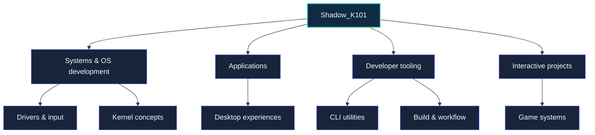
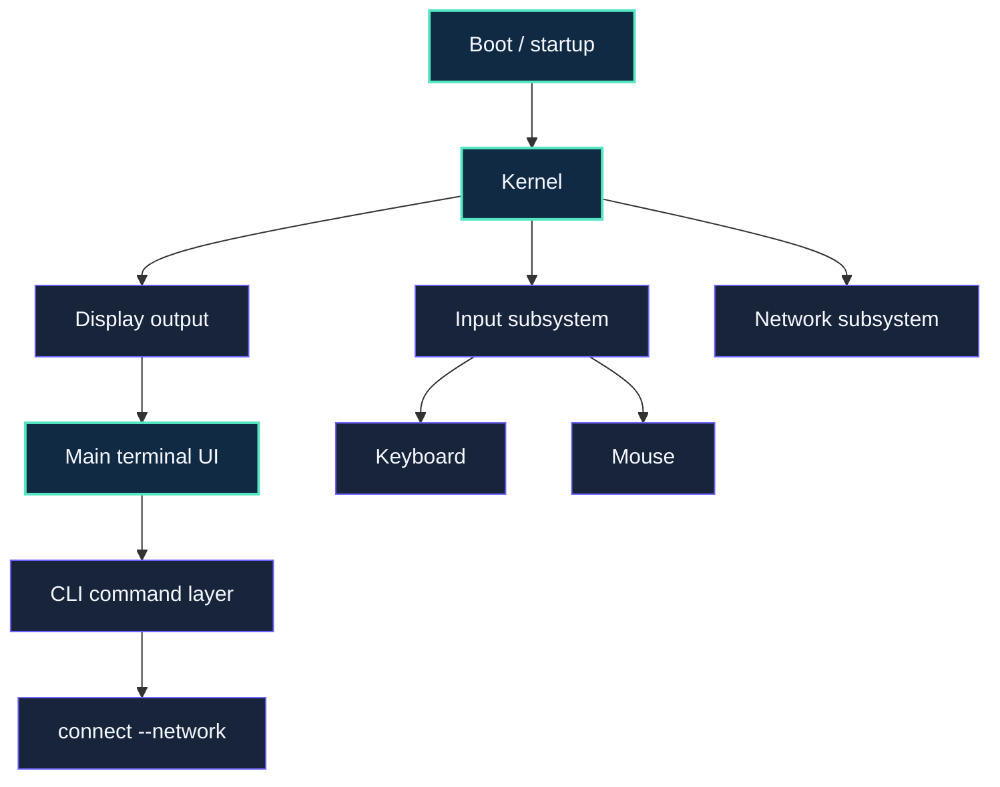
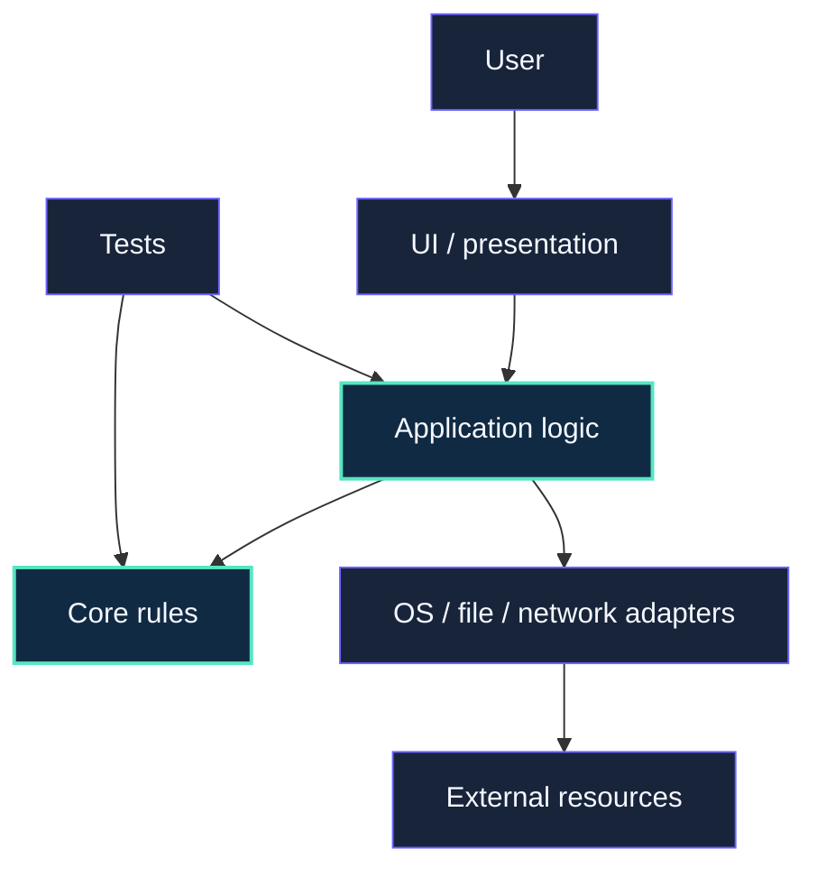
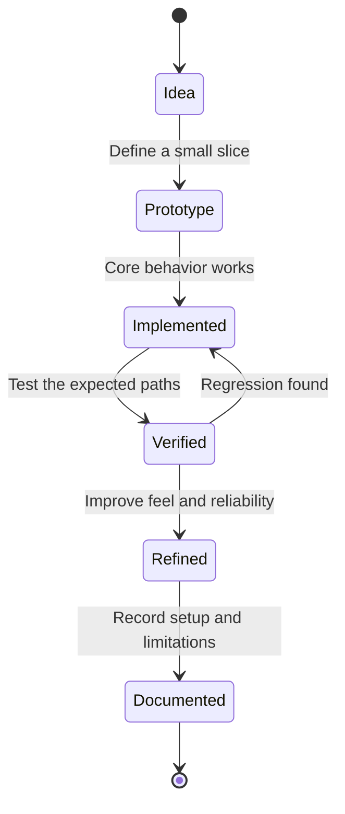
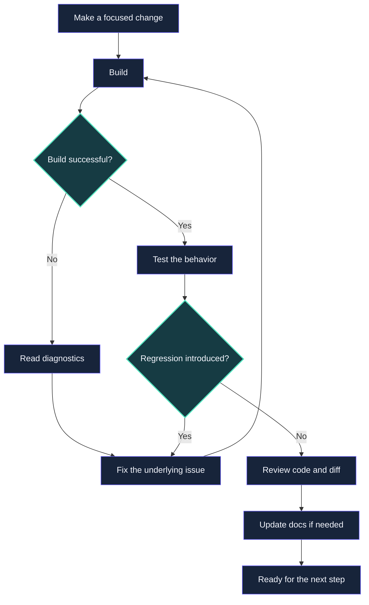

<div align="center">

<!-- Shadow_K101 | Midnight / cyan / violet visual system -->


<br/>

<a href="https://readme-typing-svg.demolab.com">
  
</a>

<br/>

<p>
  
  
  
  
</p>

<p>
  
  
  
</p>

**Developer behind `Shadow_K101` — exploring software from low-level systems and operating-system development to desktop applications, developer tools, and interactive projects.**

*Curiosity drives the idea. Engineering turns it into something real.*

</div>

---

> [!NOTE]
> This profile README is a snapshot of my interests and projects. Project status, supported platforms, and implementation details should be verified in each project's repository rather than inferred from a badge or description.

## Contents

<details open>
<summary><strong>Explore the profile</strong></summary>

- [01 — Overview](#-01--overview)
- [02 — Engineering principles](#-02--engineering-principles)
- [03 — Areas of interest](#-03--areas-of-interest)
- [04 — Featured project: CTOS](#-04--featured-project-ctos)
- [05 — Technology landscape](#-05--technology-landscape)
- [06 — What I enjoy building](#-06--what-i-enjoy-building)
- [07 — How I approach projects](#-07--how-i-approach-projects)
- [08 — Systems and low-level development](#-08--systems-and-low-level-development)
- [09 — Application development](#-09--application-development)
- [10 — Games and interactive projects](#-10--games-and-interactive-projects)
- [11 — Developer tooling](#-11--developer-tooling)
- [12 — Architecture and code organization](#-12--architecture-and-code-organization)
- [13 — Quality and testing](#-13--quality-and-testing)
- [14 — Current learning mindset](#-14--current-learning-mindset)
- [15 — Git and collaboration](#-15--git-and-collaboration)
- [16 — Security-minded development](#-16--security-minded-development)
- [17 — Documentation](#-17--documentation)
- [18 — Project workflow](#-18--project-workflow)
- [19 — Things I value in software](#-19--things-i-value-in-software)
- [20 — Roadmap](#-20--roadmap)
- [21 — GitHub profile links](#-21--github-profile-links)
- [22 — FAQ](#-22--faq)

</details>

---

## ✦ 01 — Overview

I'm **Shadow_K101**. I like understanding how software works under the hood and turning ideas into real projects. My interests span low-level programming, operating-system concepts, application development, tooling, and interactive software.

I enjoy projects where there is something substantial to figure out: how input reaches a system, how components communicate, how a clean architecture should be organized, or how to make a developer experience feel polished rather than improvised.

### What I gravitate toward

| Area | What interests me |
|---|---|
| Systems programming | Operating-system concepts, drivers, hardware interfaces, and low-level behavior |
| Application development | Desktop software, useful utilities, and clear user experiences |
| Developer tooling | CLIs, scripts, build workflows, and tools that remove friction |
| Architecture | Sensible boundaries, maintainable structure, and explicit responsibilities |
| Interactive software | Game development, input, rendering, and systems that respond to users |
| Documentation | Making projects understandable, reproducible, and easier to work on |

### At a glance



---

## ✦ 02 — Engineering principles

These are the principles I aim to bring to my projects.

### 2.1 Understand the system

- Learn how a component behaves instead of treating it as a black box.
- Follow a problem to its cause rather than hiding its symptoms.
- Make assumptions explicit, especially around hardware, platforms, and runtime behavior.
- Prefer a working mental model over blindly copying a solution.

### 2.2 Structure with purpose

- Keep files and folders organized around clear responsibilities.
- Separate unrelated subsystems so they can evolve independently.
- Avoid abstractions that add complexity without providing a real benefit.
- Make it straightforward to find where a feature belongs.

### 2.3 Treat errors as useful information

- Read compiler warnings and diagnostics carefully.
- Prefer specific, actionable error messages.
- Test changes against the failure that motivated them.
- Avoid calling something complete until its behavior has been checked.

### 2.4 Build the details, not just the demo

- Care about input handling, edge cases, and failure paths.
- Keep the user-facing experience in mind alongside the underlying implementation.
- Make startup, configuration, and common workflows understandable.
- Revisit rough edges instead of treating them as permanent.

### 2.5 Keep learning

Software development is a continuous process of experimentation, debugging, and refinement. I value projects that make me learn something new and leave me with a better understanding of the technology involved.

---

## ✦ 03 — Areas of interest

### Systems and operating systems

I’m interested in the foundations that make a computer feel like a coherent system: boot flow, kernel structure, input handling, drivers, display output, and the boundary between software and hardware.

### Programming languages and runtimes

I enjoy exploring different levels of abstraction—from C and C++ when control and system behavior matter, to C# and .NET for application and tooling work.

### User-facing software

A tool should not only work internally; it should communicate clearly, respond predictably, and make its important actions easy to discover.

### Architecture and maintainability

I like codebases where the folder structure, naming, and boundaries help explain the design instead of obscuring it.

---

## ✦ 04 — Featured project: CTOS

**CTOS** is a hobby operating-system project focused on exploring low-level systems work and building a custom boot-to-terminal experience.

The project is an opportunity to work through the pieces that sit beneath ordinary applications: startup behavior, keyboard and mouse input, display output, driver organization, and a command-line interface.

### Project areas

| Component | Direction |
|---|---|
| Boot experience | A recognizable startup flow and a custom main screen |
| Kernel and drivers | Separate responsibilities for keyboard, mouse, display, and network-related code |
| Input | Keyboard interaction, mouse movement, clicks, and scrolling |
| Terminal | A terminal-style interface ready to host commands |
| Networking | Exploring network information and a user-facing network connection flow |
| CLI commands | A dedicated place for commands so the command set can grow without mixing everything together |
| Project structure | Clear folders and interfaces between subsystems |

### Conceptual system layout



The diagram describes the intended organization, not a claim that every component or feature is already fully implemented. CTOS is a learning project, and its behavior should be judged by the current source code and build.

---

## ✦ 05 — Technology landscape

The technologies I use or explore depend on the project. This is an interest map, not a claim that every technology is used in every repository.

| Technology | Where it fits |
|---|---|
| C | Low-level code and systems concepts |
| C++ | Systems work and projects that benefit from C++ |
| C# / .NET | Application development and developer utilities |
| Git | Source control and project history |
| PowerShell | Windows development workflows and automation |
| WinUI 3 | Native Windows application development |
| Avalonia UI | Cross-platform desktop UI exploration |
| Stride Engine | Game and interactive project development |
| Markdown | Project documentation and READMEs |
| Mermaid | Architecture and workflow diagrams in Markdown |

### Toolchain habits

- Check the installed compiler, SDK, and runtime before diagnosing a build.
- Keep project-specific prerequisites documented.
- Prefer reproducible commands over undocumented setup steps.
- Treat platform-specific behavior as a requirement to verify, not an assumption.
- Keep generated outputs and local machine configuration out of source control unless a project explicitly needs them.

---

## ✦ 06 — What I enjoy building

### Low-level projects

Projects that expose how a system works: input paths, display output, memory and resource behavior, device interfaces, and startup sequences.

### Practical utilities

Small tools that solve a real problem, have clear command-line behavior, and are easy to run again later.

### Desktop experiences

Applications where architecture and presentation both matter, with attention to responsiveness, navigation, and useful error states.

### Interactive systems

Projects that combine input, state, and visible feedback—whether that means a terminal interaction, a desktop interface, or a game system.

---

## ✦ 07 — How I approach projects

I prefer to break a large idea into smaller pieces that can be built and checked independently.

```mermaid
flowchart LR
    Idea["Idea"] --> Scope["Define the scope"]
    Scope --> Structure["Design the boundaries"]
    Structure --> Build["Implement a small slice"]
    Build --> Verify["Build and test"]
    Verify --> Refine["Debug and refine"]
    Refine --> Document["Document the result"]
    Document --> Next["Choose the next slice"]
    Next --> Structure
    classDef step fill:#17243A,stroke:#6C63FF,color:#F5F7FF;
    classDef gate fill:#163B43,stroke:#55E6C1,color:#F5F7FF,stroke-width:2px;
    class Idea,Scope,Structure,Build,Refine,Document,Next step;
    class Verify gate;
```



### My general workflow

1. **Define the behavior.** Decide what the feature should do and what it should not do.
2. **Find the right boundary.** Identify the subsystem or project that should own it.
3. **Implement the smallest useful version.** Keep the change focused.
4. **Build early.** Catch compiler and integration issues before adding more complexity.
5. **Verify the real behavior.** Test the interaction or failure path, not only compilation.
6. **Clean up.** Improve names, diagnostics, structure, and documentation.
7. **Repeat.** Extend the system without losing track of its existing behavior.

---

## ✦ 08 — Systems and low-level development

Systems development rewards precision. Small details—integer sizes, calling conventions, interrupt behavior, device state, or compiler warnings—can have a large effect on the result.

### Areas I want to understand deeply

- Boot and startup flows
- Kernel and subsystem organization
- Keyboard and mouse input paths
- Display output and cursor behavior
- Driver interfaces and hardware boundaries
- Network device concepts and connection workflows
- Debugging low-level failures
- Build configuration and compiler diagnostics

### Low-level development checklist

- [ ] The target architecture and build configuration are explicit.
- [ ] Hardware and emulator assumptions are documented.
- [ ] Types, integer widths, and conversions are handled deliberately.
- [ ] Compiler warnings are reviewed rather than casually suppressed.
- [ ] Input edge cases and invalid device states are considered.
- [ ] Failure paths provide useful diagnostic information.
- [ ] New code has a clear owner and integration point.
- [ ] The behavior is verified in the intended environment.

---

## ✦ 09 — Application development

For applications, I care about both the internal design and the experience of using the finished result.

### Principles I aim for

- Keep UI code focused on presentation and interaction.
- Put reusable logic behind clear interfaces when that makes testing easier.
- Keep long-running operations from freezing the interface.
- Make loading, empty, success, and error states visible.
- Ensure keyboard navigation and focus behavior are considered.
- Avoid platform assumptions that have not been tested.
- Document how to configure, build, and run the application.

### A useful application boundary



This is a pattern to use when it helps—not a requirement to add layers to every small application.

---

## ✦ 10 — Games and interactive projects

Interactive software brings together state, input, feedback, timing, and presentation. I’m interested in how those systems fit together and how to keep them understandable as a project grows.

For projects using Stride Engine, useful areas to focus on include:

- Scene and asset organization
- Input mapping and configurable controls
- Explicit game states and transitions
- Separation of engine-dependent code from pure logic where practical
- Performance measurement before optimization
- Repeatable project setup and export steps

### Interactive feature lifecycle



---

## ✦ 11 — Developer tooling

Good tooling makes the rest of development less frustrating. I’m interested in command-line tools and scripts that make common tasks consistent and easy to repeat.

### A useful CLI should

- Provide clear `--help` output.
- Validate arguments before doing work.
- Use predictable exit codes.
- Send actionable errors to standard error.
- Avoid unexpected destructive side effects.
- Support non-interactive use when automation needs it.
- Keep secrets out of logs and command output.
- Explain prerequisites and give copyable examples.

### Example command shape

```text
tool
├── inspect
├── validate
├── build
└── clean
```

These are illustrative command names, not claims that a particular tool already implements them.

---

## ✦ 12 — Architecture and code organization

I want project structure to help explain the software. A good boundary makes it easier to understand what a component owns, how it can change, and what other components it depends on.

### Rules of thumb

- Keep related code together.
- Separate drivers, interfaces, services, and user-facing commands when they have different responsibilities.
- Avoid cyclic dependencies.
- Make shared code genuinely reusable instead of turning it into a miscellaneous folder.
- Prefer clear names over clever abbreviations.
- Keep project-specific instructions close to the project.
- Refactor when the existing structure makes a real change harder.

### Example subsystem layout

```text
Project/
├── README.md
├── src/
│   ├── Core/
│   ├── Drivers/
│   ├── Services/
│   ├── UI/
│   └── Commands/
├── tests/
└── docs/
```

This is a generic example. Actual projects should use a structure appropriate to their language, build system, and runtime.

---

## ✦ 13 — Quality and testing

A successful build is an important checkpoint, but it does not prove that every interaction behaves correctly.

### What quality means to me

| Check | Why it matters |
|---|---|
| Build | Confirms the compiler and build configuration accept the change |
| Tests | Protects logic and expected behavior |
| Manual verification | Catches real-world interaction and environment issues |
| Diagnostics | Makes failures easier to understand and fix |
| Documentation | Helps others reproduce setup and behavior |
| Regression checks | Confirms a fix has not broken an existing feature |

### Before calling a change done

- [ ] The relevant project builds.
- [ ] Warnings and errors have been reviewed.
- [ ] The intended behavior has been tested.
- [ ] Edge cases and failure paths have been considered.
- [ ] Existing functionality still works.
- [ ] The change is scoped and readable.
- [ ] Documentation reflects meaningful changes.
- [ ] No credentials or accidental local files were added.

---

## ✦ 14 — Current learning mindset

I learn best by building things, running into real problems, and tracing those problems back to their causes.

That means I value:

- Reading compiler and runtime diagnostics carefully.
- Understanding why a fix works instead of only copying it.
- Testing in the environment the project is intended to run in.
- Breaking complicated features into smaller experiments.
- Revisiting early decisions when the evidence suggests a better design.
- Recording discoveries so the same problem is easier to solve next time.

I don't expect every experiment to be perfect on the first attempt. I do expect each iteration to make the project—or my understanding of it—better.

---

## ✦ 15 — Git and collaboration

Version control is most useful when the history explains the work.

### Habits worth keeping

- Make focused commits.
- Use descriptive commit messages.
- Review the diff before committing.
- Keep unrelated formatting changes out of focused bug fixes.
- Include reproduction steps when fixing a bug.
- Document breaking changes and setup requirements.
- Never commit secrets, credentials, or generated build outputs unintentionally.

### Example commit messages

```text
feat(ctos): add terminal command routing
fix(input): handle mouse movement bounds
refactor(drivers): clarify subsystem ownership
docs(readme): document local build steps
test(core): cover invalid command arguments
```

These are examples of a consistent style, not a record of existing commits.

---

## ✦ 16 — Security-minded development

Security belongs in everyday engineering decisions, even in personal projects.

- Keep passwords, tokens, and private keys out of source control.
- Use safe example configuration instead of real credentials.
- Validate data at system boundaries.
- Treat external input and downloaded assets as untrusted.
- Avoid exposing sensitive information in logs.
- Keep dependencies and toolchains deliberate.
- Document security limitations honestly.
- If a credential is accidentally committed, revoke or rotate it; deleting it from the latest file is not enough to remove it from Git history.

---

## ✦ 17 — Documentation

Documentation is part of the project, not a task to leave indefinitely until later.

A useful project README should explain:

1. What the project is for.
2. Its current status and known limitations.
3. The tools and versions needed.
4. How to build, test, and run it.
5. How the main components fit together.
6. Where important files live.
7. How to reproduce common problems.
8. What is planned next.

I like documentation that is detailed enough to be useful while staying honest about what is implemented, what is experimental, and what still needs verification.

---

## ✦ 18 — Project workflow



The aim is to keep feedback loops short. Catching a problem while the change is small is usually easier than diagnosing it after several unrelated changes have accumulated.

---

## ✦ 19 — Things I value in software

- **Clarity:** the design and code should be understandable.
- **Functionality:** features should do what they claim to do.
- **Maintainability:** future changes should not require unnecessary guesswork.
- **Honest status:** experimental, incomplete, and verified features should be distinguishable.
- **Good diagnostics:** failures should point toward the next useful action.
- **Thoughtful UX:** even technical tools benefit from predictable interaction.
- **Reproducibility:** another run or another machine should not depend on hidden steps.
- **Curiosity:** understand the reason behind a behavior, not only the workaround.

---

## ✦ 20 — Roadmap

This is a direction-of-interest list rather than a promise that every item is currently underway.

| Area | Direction |
|---|---|
| CTOS | Continue improving system structure, input, terminal behavior, and driver boundaries |
| Systems programming | Build a deeper understanding of low-level interfaces and debugging |
| Developer tooling | Create useful, repeatable workflows and utilities |
| Application development | Improve architecture, responsiveness, and user-facing polish |
| Interactive projects | Explore clean input, state, and gameplay systems |
| Documentation | Keep project setup, structure, and limitations easy to understand |
| Engineering practice | Improve testing, diagnostics, and maintainability with each iteration |

---

## ✦ 21 — GitHub profile links

<div align="center">

<a href="https://github.com/Shadow_K101">
  
</a>
<a href="https://github.com/Shadow_K101?tab=repositories">
  
</a>

<br/><br/>

<a href="https://github.com/Shadow_K101">
  
</a>
<a href="https://github.com/Shadow_K101">
  
</a>

<br/>


</div>

> [!TIP]
> These cards are generated by third-party services and may occasionally be unavailable or rate-limited. Language statistics reflect detectable public repository code, not a complete measure of skill or experience.

---

## ✦ 22 — FAQ

<details>
<summary><strong>What kind of developer is Shadow_K101?</strong></summary>

A developer exploring a mix of low-level systems, operating-system concepts, application development, developer tooling, and interactive projects. The exact focus changes as projects evolve.
</details>

<details>
<summary><strong>What is CTOS?</strong></summary>

CTOS is a hobby operating-system project focused on learning and building a custom startup, input, driver, and terminal experience. Check its repository for the current implementation status.
</details>

<details>
<summary><strong>Are all the technologies listed used in every project?</strong></summary>

No. The technology section describes areas I use or explore. Each project has its own requirements and should document its actual toolchain.
</details>

<details>
<summary><strong>Do the profile statistics prove experience with a language?</strong></summary>

No. Automatically generated language cards generally measure public repository content. They do not measure proficiency, project complexity, or the full range of work.
</details>

<details>
<summary><strong>How can I find my projects?</strong></summary>

Visit the [repositories page](https://github.com/Shadow_K101?tab=repositories) to browse the projects currently published on GitHub.
</details>

---

<div align="center">


**SHADOW_K101**

*Understand the system. Build with purpose. Improve every iteration.*

<sub>Systems • Software • Tooling • Interactive Projects</sub>

<br/><br/>

<a href="#-01--overview">Back to top ↑</a>

</div>
