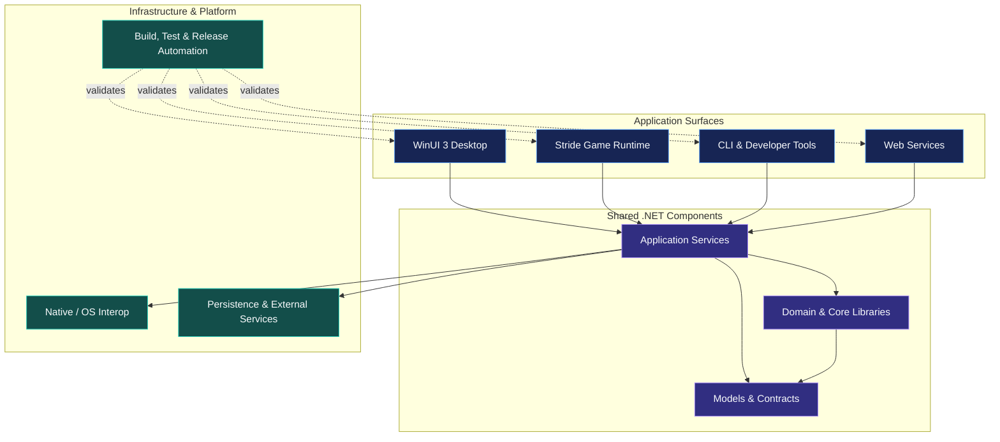

 <div align="center">


### Principal Windows Desktop & Game Engineer at Asteria Interactive™

**Designing Windows experiences. Engineering real-time worlds. Shipping reliable software.**

<a href="https://github.com/ShadowK101">
  
</a>

<br/>

<a href="https://github.com/ShadowK101">
  
</a>
<a href="https://github.com/Asteria-Interactive">
  
</a>


<br/><br/>

<a href="#-engineering-overview">Overview</a> ·
<a href="#-core-engineering-domains">Engineering Domains</a> ·
<a href="#-windows-desktop-engineering">Windows</a> ·
<a href="#-real-time-game-engineering">Game Development</a> ·
<a href="#-architecture--engineering-principles">Architecture</a> ·
<a href="#-toolchain--delivery">Toolchain</a> ·
<a href="#-github-activity">GitHub Activity</a> ·
<a href="#-connect">Connect</a>

</div>

---

## 🧭 Engineering Overview

I work across the full engineering lifecycle at **Asteria Interactive™**, with a focus on modern Windows desktop applications, real-time game development, graphics programming, and the infrastructure that turns source code into dependable releases.

My active engineering stack is built around **C# 14 and .NET 10**, with two primary application surfaces:

- **Windows desktop:** WinUI 3, XAML, the Windows App SDK, Fluent design, accessibility, and production packaging.
- **Real-time games:** Stride Engine, C# gameplay systems, SDSL/HLSL shaders, rendering workflows, and asset pipelines.

Around those foundations, I build shared libraries, developer tooling, automated validation, and repeatable release workflows.

<table>
<tr>
<td width="50%" valign="top">

### 🪟 Windows Engineering

- WinUI 3 and XAML
- Windows App SDK
- MVVM and dependency injection
- Fluent UI, Mica and adaptive layouts
- Accessibility and localization
- MSIX and application distribution

</td>
<td width="50%" valign="top">

### 🎮 Game Engineering

- Stride Engine and Game Studio
- C# gameplay architecture
- Entity-component systems
- SDSL and HLSL shaders
- Asset, scene and prefab workflows
- Rendering and performance profiling

</td>
</tr>
<tr>
<td width="50%" valign="top">

### 🧱 Software Architecture

- UI-independent .NET libraries
- Explicit dependency boundaries
- Async APIs and cancellation
- Source-generated interop
- Testable application services
- Maintainable data contracts

</td>
<td width="50%" valign="top">

### ⚙️ Build & Release Engineering

- MSBuild and `dotnet` CLI
- NuGet Central Package Management
- GitHub Actions
- Automated tests and analyzers
- Signed application packages
- Reproducible release workflows

</td>
</tr>
</table>

> **Engineering philosophy:** build the right abstraction, keep boundaries explicit, measure real performance, automate repeatable work, and treat release quality as part of the product.

---

## 🧩 Core Engineering Domains

### 🔷 C# 14 & .NET 10

Modern managed development across application logic, tooling, services, and shared libraries.

- Nullable reference types and explicit API contracts.
- Records and `required` members where they improve data modelling.
- `async` / `await`, cancellation propagation, and asynchronous I/O.
- `Span<T>` and `Memory<T>` when profiling demonstrates a benefit.
- Source generation where it improves startup, maintainability, or trimming compatibility.
- Automated tests, analyzers, and compiler diagnostics as engineering feedback.

### 🪟 WinUI 3 & Windows App SDK

Desktop applications designed around Windows conventions, clear navigation, and maintainable presentation logic.

- MVVM with CommunityToolkit.Mvvm.
- Dependency injection and application composition.
- XAML resources, templates, and theme-aware styling.
- Custom windowing and title-bar integration.
- DPI-aware, adaptive layouts and keyboard navigation.
- Accessibility, localization, and reliable application settings.
- Packaged and unpackaged deployment strategies where appropriate.

### 🎮 Stride Engine

C#-first game development with an emphasis on clear gameplay systems, maintainable content, and measurable runtime performance.

- `SyncScript`, `AsyncScript`, and `StartupScript` for appropriate gameplay responsibilities.
- Entity-component architecture and data-oriented processing where justified.
- Scene and prefab composition.
- Materials, lighting, animation, input, physics, and audio.
- Game Studio workflows and structured content management.
- Save systems, platform integrations, and build automation.

### 🎨 Graphics, Shaders & Rendering

Rendering work that connects artistic intent with predictable runtime behaviour.

- Stride Shader Language (SDSL) and HLSL.
- Shader composition, material variants, and custom effects.
- Post-processing and rendering extensions.
- GPU debugging and frame-time investigation.
- RenderDoc and PIX workflows where supported by the target graphics backend.
- Performance budgets based on measured frame times and GPU captures.

### 🧱 Platform & Native Interoperability

Managed application architecture with native integration kept at explicit boundaries.

- `LibraryImport` and source-generated P/Invoke where supported.
- CsWin32-generated Windows bindings.
- COM interoperability and lifetime management.
- `SafeHandle` for owned native resources.
- Narrow interfaces around platform-specific functionality.
- Native code only when a concrete requirement justifies it.

### 🧪 Quality & Performance

Quality is part of the development workflow, not a final cleanup step.

- Unit tests for domain and application logic.
- UI automation for appropriate desktop workflows.
- Headless testing for game logic where feasible.
- Roslyn analyzers and formatting checks.
- BenchmarkDotNet for repeatable microbenchmarks.
- `dotnet-trace`, `dotnet-counters`, and PerfView for runtime investigation.
- Frame-time, allocation, and responsiveness measurements.

---

## 🏗️ Architecture & Engineering Principles

The central architectural goal is to keep application rules independent of the UI framework and game runtime wherever practical.



<sub>Conceptual architecture: exact project boundaries and dependency directions should be reflected in the relevant solution files.</sub>

### The boundaries I aim for

| Layer | Responsibility | Design goal |
|---|---|---|
| Presentation | Windows UI or in-game interaction | Keep rendering and interaction concerns at the edges |
| Application | Use cases and orchestration | Coordinate work through explicit contracts |
| Domain | Business rules and core behaviour | Avoid unnecessary framework dependencies |
| Infrastructure | Storage, platform APIs and integrations | Isolate implementation details behind interfaces |
| Tooling | Builds, validation and distribution | Make repeatable operations automated and observable |

### Seven engineering principles

1. **C# first, with the right tool for each layer.** Use SDSL/HLSL for GPU work and native interop for explicit platform requirements.
2. **The UI is a shell, not the foundation.** Core rules should be testable without launching a window.
3. **The engine is a runtime, not the entire architecture.** Keep reusable game rules and data models independent where that separation makes sense.
4. **Measure before optimizing.** Profile real workloads before introducing pooling, unsafe code, or additional complexity.
5. **Treat diagnostics as useful feedback.** Enable nullable analysis, enforce agreed quality gates, and resolve meaningful warnings.
6. **Make builds repeatable.** Pin toolchains and dependencies where appropriate, and automate validation.
7. **Ship deliberately.** Test release artefacts, protect signing credentials, and document distribution procedures.

---

## 🪟 Windows Desktop Engineering

My Windows desktop focus is on applications that feel native to Windows while retaining clean internal architecture.

<details>
<summary><strong>Expand the WinUI 3 engineering playbook</strong></summary>

| Concern | Approach |
|---|---|
| Application pattern | MVVM and testable view models |
| Composition | Dependency injection and an explicit composition root |
| Navigation | Clear navigation contracts and predictable activation |
| Windowing | Windows App SDK window APIs and custom title bars where needed |
| Theming | Resource dictionaries and theme-aware brushes |
| Layout | Adaptive visual states, DPI-aware assets, and responsive sizing |
| Accessibility | Keyboard navigation, accessible labels, focus visibility, and assistive-technology checks |
| Localization | Resource-based strings and localization validation |
| Data | Explicit serialization contracts and suitable local persistence |
| Concurrency | Async operations, cancellation, and deliberate UI-thread dispatch |
| Packaging | MSIX or unpackaged deployment, selected for the application's distribution needs |
| Diagnostics | Structured logging, crash investigation, profiling, and UI debugging |

</details>

### Desktop engineering priorities

- Keep view models independent of XAML controls wherever possible.
- Avoid blocking the UI thread with synchronous I/O or `.Result` / `.Wait()` calls.
- Make window state, navigation, and settings predictable.
- Design accessibility and localization into the UI rather than adding them at the end.
- Test packaging and installation separately from the development experience.

---

## 🎮 Real-Time Game Engineering

I use Stride Engine for C#-oriented game development, with gameplay architecture and content workflows designed to remain maintainable as projects grow.

<details>
<summary><strong>Expand the Stride engineering playbook</strong></summary>

| Concern | Approach |
|---|---|
| Gameplay | Scripts and component-based systems suited to each responsibility |
| Architecture | Separate game rules from engine-specific integration where practical |
| Content | Reusable scenes, prefabs, materials, and clearly organized assets |
| Rendering | Lighting, materials, effects, and measured rendering budgets |
| Shaders | SDSL/HLSL workflows and controlled shader complexity |
| Physics | Collision layers, appropriate fixed-step behaviour, and repeatable tests |
| Input | Action-oriented controls for keyboard, mouse, and gamepad |
| UI | In-game UI designed around the needs of the game |
| Persistence | Versioned save formats and deliberate migration handling |
| Performance | Frame-time profiling, allocation investigation, and GPU captures |
| Platform services | Explicit integrations for distribution, achievements, or cloud saves when required |
| Release | Validated builds, platform-specific packaging, and tested release artefacts |

</details>

### Game performance priorities

- Establish a frame-time budget before optimizing individual systems.
- Separate per-frame work from initialization and infrequent operations.
- Watch allocations and garbage-collection behaviour in hot paths.
- Profile CPU and GPU bottlenecks independently.
- Treat asset import settings, texture sizes, shader variants, and scene complexity as performance concerns.
- Validate release builds on the intended target hardware.

---

## ⚙️ Toolchain & Delivery

A reliable engineering workflow needs more than a successful local build. The goal is to make validation repeatable and release outputs trustworthy.

<div align="center">


</div>

### Core toolchain

| Area | Technologies |
|---|---|
| Language & runtime | C# 14, .NET 10 |
| Desktop | WinUI 3, XAML, Windows App SDK |
| Games | Stride Engine, Game Studio, SDSL/HLSL |
| Build system | MSBuild, `dotnet` CLI |
| Dependencies | NuGet, Central Package Management, lock files where appropriate |
| IDEs | Visual Studio, JetBrains Rider |
| Quality | Roslyn analyzers, `.editorconfig`, xUnit / MSTest |
| Performance | BenchmarkDotNet, `dotnet-trace`, `dotnet-counters`, PerfView |
| Automation | GitHub Actions, PowerShell, Bash |
| Distribution | MSIX and other project-appropriate release packaging |
| Graphics investigation | RenderDoc and PIX, as appropriate to the target backend |

### A typical delivery pipeline


### Build and validation example

The following is a **template** for a repository whose solution and projects support these commands. Adapt paths and restore settings to the actual workspace.

```powershell
# Inspect installed SDKs and restore local tools
dotnet --list-sdks
dotnet tool restore

# Restore dependencies
dotnet restore

# Build and test the solution
dotnet build -c Release --no-restore
dotnet test -c Release --no-build

# Verify formatting if the repository enforces dotnet format
dotnet format --verify-no-changes
```

### Release engineering checklist

- [ ] SDK and dependency versions are controlled.
- [ ] Restore and build complete in a clean environment.
- [ ] Required tests and analyzers pass.
- [ ] Release configuration and target architecture are correct.
- [ ] Signing credentials are protected and never committed.
- [ ] The final package installs and launches on a clean test machine.
- [ ] Symbols, logs, checksums, and software inventory are retained as appropriate.

---

## 📊 GitHub Activity

<div align="center">

<a href="https://github-profile-trophy.vercel.app/?username=ShadowK101&theme=discord&no-frame=true&no-bg=true&column=6">
  
</a>

<br/><br/>

<a href="https://github-stats-extended.vercel.app">
  
</a>

<a href="https://github-stats-extended.vercel.app">
  
</a>

<br/><br/>


<br/><br/>


<br/>


</div>

<sub>These widgets are supplied by third-party services. Their availability and displayed metrics depend on those services and GitHub's public data.</sub>

---

## 🎯 Current Engineering Focus

- **Windows desktop:** polished WinUI 3 applications with maintainable architecture and accessible interaction.
- **Real-time games:** Stride gameplay systems, shader development, content workflows, and performance analysis.
- **Shared foundations:** reusable .NET components with clear boundaries and focused responsibilities.
- **Developer experience:** automated validation, reliable local builds, and predictable release workflows.
- **Performance engineering:** use profiling and measurements to guide improvements rather than optimizing by assumption.

---

## 📬 Connect

<div align="center">

<a href="https://github.com/ShadowK101">
  
</a>
<a href="https://github.com/Asteria-Interactive">
  
</a>

<br/><br/>

<a href="https://x.com/Shadow_K101">
  
</a>
<a href="https://discord.com/users/11644249975077448862">
  
</a>
<a href="mailto:KeeganMos@outlook.com">
  
</a>

<br/><br/>

**Asteria Interactive™ · C# · .NET · WinUI 3 · Stride Engine**

*Engineering software with intent. Building experiences with purpose.*


</div>
