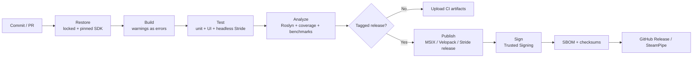

<div align="center">


<h3>⚡ Principal Windows Desktop &amp; Game Engineer at Asteria Interactive™</h3>

<a href="https://github.com/ShadowK101">

</a>

<br/><br/>

<p align="center">
<a href="https://skillicons.dev">

</a>
</p>

<br/>

<!-- LANGUAGES & RUNTIME -->
<p align="center">


</p>

<!-- BUILD + TOOLCHAIN -->
<p align="center">


</p>

<!-- PLATFORMS -->
<p align="center">


</p>

<!-- IDES -->
<p align="center">
<a href="https://visualstudio.microsoft.com/"></a>
<a href="https://www.jetbrains.com/rider/"></a>
<a href="https://www.stride3d.net/"></a>
<a href="https://github.com/features/actions"></a>
</p>

<!-- CONTACT -->
<p align="center">
<a href="https://x.com/Shadow_K101">

</a>
<a href="https://discord.com/users/11644249975077448862">

</a>
<a href="mailto:KeeganMos@outlook.com">

</a>
<a href="https://github.com/Asteria-Interactive">

</a>

</p>

<p align="center">
<a href="#-executive-overview">Overview</a> •
<a href="#-core-technical-domains">Core Domains</a> •
<a href="#-technical-domain-matrix">Domain Matrix</a> •
<a href="#-what-i-build-day-to-day">Day to Day</a> •
<a href="#-winui-3-desktop-playbook">WinUI 3</a> •
<a href="#-stride-game-development-playbook">Stride</a> •
<a href="#-system-architecture">Architecture</a> •
<a href="#-live-github-activity-metrics">Live Stats</a>
</p>

</div>

---

## 📊 Live GitHub Activity Metrics

<div align="center">

<p align="center">

</p>

<p align="center">
<a href="https://github-stats-extended.vercel.app">

</a>
</p>

<br/>

<p align="center">
<a href="https://github-stats-extended.vercel.app">

</a>
</p>

<br/>

<p align="center">

</p>

<br/>


</div>

---

## 🧾 Executive Overview

Principal engineer at **Asteria Interactive™** with end-to-end ownership of **Windows desktop products** and **real-time 3D games**, written in **C# 14 on .NET 10**, with **WinUI 3** for the desktop shell and **Stride** for the game runtime.

I design and ship:

- 🪟 **WinUI 3 desktop apps**: Fluent, Mica-backed, DPI-correct, accessible apps built on the Windows App SDK, packaged as signed MSIX or shipped unpackaged, on x64 and ARM64.
- 🎮 **Stride games and tools**: C#-first gameplay on an ECS-style scene graph, custom SDSL shaders and render features, a disciplined asset pipeline, and Steam-ready builds.
- 🧊 **UI-free core libraries**: small, testable .NET class libraries with no reference to WinUI or Stride, so the same logic powers the app, the game, the CLI, and the test suite.
- 🧱 **Native interop where it counts**: `LibraryImport` / CsWin32 source-generated P/Invoke, COM interop, and `Span<T>`-based hot paths, always behind a managed abstraction.
- 🤖 **Deterministic build & release automation**: pinned SDKs, central package management, locked restores, signed artifacts, and SBOMs on every release.

Build graphs are **MSBuild via the `dotnet` CLI**, with **NuGet Central Package Management** and **locked restores** for dependencies, a pinned SDK through `global.json`, and **GitHub Actions** for CI. Day-to-day IDEs are **Visual Studio** (WinUI designer, XAML Hot Reload, Stride Game Studio integration) and **JetBrains Rider** (analysis, refactoring, profiling).

> **Note:** The earlier native **C / C++ / Rust / Assembly / Qt 6** track has been **retired** from active work. Active work is **C# / .NET**: WinUI 3 desktop software and Stride game development. Native code remains in git history only, and is reached today solely through interop.

---

## 🧩 Core Technical Domains

> ### 🔷 C# & .NET Engineering
> Architecture and production implementation in **C# 14 / .NET 10 (LTS)**: nullable reference types everywhere, records and `required` members for clear data contracts, `Span<T>` / `Memory<T>` on hot paths, `async`/`await` with cancellation end to end, source generators over reflection, and zero-warning builds with analyzers set to error.

> ### 🪟 WinUI 3 & Windows App SDK
> Cross-device Windows desktop products in **WinUI 3 / XAML**: MVVM with **CommunityToolkit.Mvvm**, dependency injection through **Microsoft.Extensions.Hosting**, Fluent design with Mica / Acrylic and custom title bars via `AppWindow`, adaptive layouts, keyboard-first navigation, UI Automation for Narrator, `.resw` localization, and **MSIX** packaging with auto-update.

> ### 🎮 Stride Game Development
> Real-time 3D and 2D games on the **Stride Engine**: `SyncScript` / `AsyncScript` / `StartupScript` gameplay, entity-component processors for data-heavy systems, prefab-driven content, Bepu-based physics, spatial audio, Stride UI, scene streaming, and **Game Studio** workflows that keep assets diffable and mergeable.

> ### 🎨 Graphics, Shaders & Rendering
> Custom visuals through **SDSL** (Stride Shader Language) and **HLSL**: composable shader mixins, custom `.sdfx` effects, post-processing chains, render features, and GPU debugging with RenderDoc and PIX. Vulkan and Direct3D back-ends are tested, not assumed.

> ### 🧱 Platform Engineering & Tooling
> `global.json`, `Directory.Build.props`, `Directory.Packages.props`, `packages.lock.json`, `.editorconfig`, local `dotnet` tool manifests, GitHub Actions matrices, **MSIX** and **Velopack** packaging, Azure Trusted Signing / Authenticode, SBOM generation, SourceLink, and Git LFS for art, audio, and installers.

> ### 🧪 Quality, Testing & Performance
> xUnit / MSTest unit suites, headless Stride tests, UI automation for WinUI, **BenchmarkDotNet** micro-benchmarks, `dotnet-trace` / `dotnet-counters` / PerfView for CPU and GC, frame-budget tracking in games, and analyzers (Roslyn, StyleCop, Meziantou) enforced in CI.

---

## 📐 Technical Domain Matrix

| Domain Layer | Primary Technologies & Tooling | Focus Areas |
| :-- | :-- | :-- |
| **Core libraries (`src/Desktop/Systems`)** | C# 14, .NET 10, `System.Text.Json` source-gen, `Span<T>`, CsWin32 | UI-free domain logic, services, serialization, interop shims |
| **Desktop (`src/Desktop/WinUI-Desktop`)** | WinUI 3, Windows App SDK, XAML, CommunityToolkit.Mvvm, MSIX | Shippable Fluent desktop apps with testable view models |
| **Games (`src/Desktop/Games`)** | Stride Engine, Game Studio, SDSL / HLSL, Bepu physics | Gameplay, rendering features, asset pipeline, Steam builds |
| **Web (`src/Web`)** | ASP.NET Core, Blazor, minimal APIs, static sites | Companion services, docs sites, licensing & update endpoints |
| **Tooling (`src/Tools`)** | PowerShell, Bash, GitHub Actions, `dotnet` tools, Node / Python helpers | Deterministic builds, signing, packaging, release automation |
| **Quality** | Roslyn analyzers, `.editorconfig`, xUnit, BenchmarkDotNet, coverlet | Warnings-as-errors, coverage gates, benchmark regression checks |
| **Supply Chain** | NuGet CPM, `packages.lock.json`, Dependabot, SBOM, SourceLink | Pinned, audited, reproducible dependencies |
| **IDEs** | Visual Studio, JetBrains Rider, Stride Game Studio | XAML Hot Reload, profiling, scene and asset authoring |
| ~~**Legacy native stack**~~ | ~~C17, C++20/23, Rust, NASM/MASM, Qt 6, CMake, vcpkg~~ | *Retired: git history only* |

---

## 🎯 Core Active Directives

- 🪟 **WinUI 3 desktop products:** MVVM apps whose logic is testable without a window (`src/Desktop/WinUI-Desktop`).
- 🎮 **Stride games & game tools:** C#-first gameplay, custom shaders, and a clean asset pipeline (`src/Desktop/Games`).
- 🧊 **Shared .NET core:** UI-free libraries consumed by apps, games, CLIs, and tests (`src/Desktop/Systems`).
- 🧱 **Interop at the edges:** source-generated P/Invoke and COM wrappers, never raw handles in app code.
- 🤖 **One deterministic pipeline:** pinned SDKs, locked restores, signed MSIX and game builds on every release (`src/Tools`).
- 🌐 **Thin web surface:** small ASP.NET Core / Blazor services that support the desktop and game products (`src/Web`).

---

## 🔨 What I Build Day to Day

| Surface | Typical week |
|---------|--------------|
| 🔷 **C# core** | Service interfaces, `record` models, `IAsyncEnumerable` pipelines, analyzer cleanups, public API reviews |
| 🪟 **WinUI 3** | XAML templates and styles, view models, navigation, theming, title bars, settings pages, MSIX packaging |
| 🎮 **Stride gameplay** | Player controllers, AI behaviors, input maps, save systems, scene and prefab composition, UI screens |
| 🎨 **Shaders & rendering** | SDSL mixins, custom effects, post-processing, material variants, GPU captures, frame-time budgets |
| 🧱 **Interop** | CsWin32 bindings, `LibraryImport` signatures, COM wrappers, Steamworks integration, SafeHandle audits |
| 🧪 **Testing** | xUnit suites, UI automation, headless Stride tests, BenchmarkDotNet baselines, coverage reports |
| 🤖 **Platform** | `Directory.Build.props`, CI matrices, signing, Velopack / MSIX releases, SteamPipe uploads, SBOMs |

**Language rule:** C# everywhere by default; HLSL / SDSL for the GPU; PowerShell and Bash for automation; native code only behind a managed interop boundary. Libraries know nothing about WinUI or Stride; each is a presentation or runtime shell around shared logic.

---

## 🪟 WinUI 3 Desktop Playbook

<details>
<summary><b>Click to expand how WinUI 3 apps are structured and shipped</b></summary>
<br/>

| Concern | Approach |
| :-- | :-- |
| **Pattern** | MVVM with `CommunityToolkit.Mvvm` source generators (`[ObservableProperty]`, `[RelayCommand]`); view models have no `Microsoft.UI.Xaml` references |
| **Composition** | `Microsoft.Extensions.Hosting` + DI; one composition root in `App.xaml.cs`; services behind interfaces |
| **Navigation** | `NavigationView` shell, a navigation service abstraction, deep-link and protocol activation |
| **Windowing** | `AppWindow` APIs, custom title bar, Mica / Mica Alt backdrops, multi-window support, window-state persistence |
| **Theming** | Light, Dark, and High Contrast resource dictionaries; accent-aware brushes; no hard-coded colors in views |
| **Layout** | Adaptive visual states, effective-pixel sizing, DPI-aware assets (`scale-*` / `targetsize-*`) |
| **Accessibility** | `AutomationProperties`, keyboard tab order, Narrator passes, contrast checks, focus visuals |
| **Localization** | `.resw` resources, `x:Uid` bindings, pseudo-locale testing |
| **Data** | `System.Text.Json` source generation, SQLite via `Microsoft.Data.Sqlite`, `ApplicationData` / local-folder settings |
| **Concurrency** | `DispatcherQueue` marshalling, `CancellationToken` everywhere, no `.Result` / `.Wait()` on the UI thread |
| **Packaging** | Packaged (MSIX) and unpackaged-with-external-location modes, `.appinstaller` auto-update, ARM64 + x64 bundles |
| **Signing** | Azure Trusted Signing / Authenticode in CI, timestamped signatures, signed installers and binaries |
| **Diagnostics** | Structured logging (`Microsoft.Extensions.Logging`), crash reporting, `dotnet-trace`, XAML Hot Reload, Live Visual Tree |

</details>

---

## 🎮 Stride Game Development Playbook

<details>
<summary><b>Click to expand how Stride projects are structured and shipped</b></summary>
<br/>

| Concern | Approach |
| :-- | :-- |
| **Project layout** | `[Game].Game` (shared code and assets), `[Game].Windows` (platform launcher), optional `[Game].Linux`, plus an `[Game].sdpkg` package file |
| **Gameplay** | `SyncScript` for per-frame logic, `AsyncScript` for sequences and flows, `StartupScript` for init; data-heavy systems as `EntityProcessor<T>` |
| **Content** | Scene and prefab composition, `.sdscene` / `.sdprefab` YAML assets kept merge-friendly; source art in `Resources/`, authored assets in `Assets/` |
| **Rendering** | Forward+ / clustered lighting, PBR materials, custom render features, post-processing stack, LOD and culling budgets |
| **Shaders** | SDSL mixins and `.sdfx` effects, generated `.sdsl.cs` files treated as build output, HLSL fallbacks for isolated passes |
| **Physics** | Bepu-based rigid bodies, character controllers, triggers, layered collision filtering, deterministic fixed-step tests |
| **Audio** | Spatialized sound, music layering, bus routing, optional middleware (FMOD / Wwise) behind an interface |
| **Input & UI** | Action-mapped input (keyboard, mouse, gamepad), Stride UI for in-game screens, WinUI-hosted tooling for editors and launchers |
| **Persistence** | Versioned save files, `System.Text.Json` source generation, migration steps, corruption-safe atomic writes |
| **Performance** | Frame-time and allocation budgets per system, `ArrayPool<T>` / object pooling, GC pause tracking, RenderDoc / PIX captures |
| **Platform services** | Steamworks integration (achievements, cloud saves), SteamPipe builds, crash dumps symbolicated with SourceLink |
| **Shipping** | Release publish profiles, trimmed and ReadyToRun builds where supported, signed executables, per-depot Steam uploads |

</details>

---

## 🧱 System Architecture

<details>
<summary><b>Click to expand Execution Stack & Component Boundaries</b></summary>
<br/>

```text
┌──────────────────────────────────────────────────────────────────────────────┐
│ Desktop apps: WinUI 3 / XAML / Windows App SDK                               │
│ Path: src/Desktop/WinUI-Desktop/[App_Name]                                   │
├──────────────────────────────────────────────────────────────────────────────┤
│ Games: Stride Engine / Game Studio / SDSL                                    │
│ Path: src/Desktop/Games/[Game_Name]                                          │
├──────────────────────────────────────────────────────────────────────────────┤
│ Presentation logic: view models, game-state machines (UI- and engine-free)   │
│ Path: src/Desktop/Systems/[Name].Presentation                                │
├──────────────────────────────────────────────────────────────────────────────┤
│ Application services & domain: .NET 10 class libraries, DI-friendly          │
│ Path: src/Desktop/Systems/[Name].Core                                        │
├──────────────────────────────────────────────────────────────────────────────┤
│ Interop layer: CsWin32 · LibraryImport · COM wrappers · Steamworks           │
│ Path: src/Desktop/Systems/[Name].Interop                                     │
├──────────────────────────────────────────────────────────────────────────────┤
│ Web surface: ASP.NET Core / Blazor companion services                        │
│ Path: src/Web/[Service_Name]                                                 │
├──────────────────────────────────────────────────────────────────────────────┤
│ Automation: MSBuild props, PowerShell / Bash, GitHub Actions, dotnet tools   │
│ Path: src/Tools                                                              │
├──────────────────────────────────────────────────────────────────────────────┤
│ Target platforms: Windows 11 (x64 / ARM64) · Linux (CI, servers, tooling)    │
└──────────────────────────────────────────────────────────────────────────────┘
```

</details>

<details>
<summary><b>Click to expand Repository Layout</b></summary>
<br/>

```text
Workspace/
└── src/
    ├── Desktop/
    │   ├── Systems/                 # UI-free .NET libraries (Core, Presentation, Interop)
    │   ├── WinUI-Desktop/           # WinUI 3 apps, one folder per app
    │   └── Games/                   # Stride projects, one folder per game
    │       └── [Game_Name]/
    │           ├── [Game_Name].Game/        # shared code, Assets/, Resources/, Effects/
    │           ├── [Game_Name].Windows/     # platform launcher
    │           └── [Game_Name].sdpkg        # Stride package definition
    ├── Tools/
    │   ├── Build/                   # build orchestration scripts
    │   ├── CI/                      # GitHub Actions helpers
    │   └── Scripts/                 # PowerShell / Bash utilities
    └── Web/                         # ASP.NET Core / Blazor services and sites
```

</details>

<details>
<summary><b>Click to expand Build &amp; Release Pipeline</b></summary>
<br/>



</details>

---

## ✅ Quality Gates

| Gate | Enforcement |
| :-- | :-- |
| **Compiler** | `Nullable=enable`, `TreatWarningsAsErrors=true`, `AnalysisMode=All` on shipping projects |
| **Style** | `.editorconfig` as the single source of truth, `dotnet format --verify-no-changes` in CI |
| **Dependencies** | Central Package Management, `RestoreLockedMode=true`, Dependabot, vulnerability audit on restore |
| **Tests** | Unit tests required for core libraries; view models tested without a window; gameplay logic tested headless |
| **Performance** | BenchmarkDotNet baselines for hot paths; frame-time and allocation budgets tracked for games |
| **Reproducibility** | `Deterministic=true`, `ContinuousIntegrationBuild=true`, SourceLink, embedded symbols |
| **Release** | Signed binaries and installers, SBOM attached, checksums published with every release |

---

## 🧠 Engineering Principles (personal)

1. **C# first, right tool per layer.** C# for apps, games, and tooling; HLSL / SDSL for the GPU; native code only behind a managed boundary.
2. **The UI is a shell, not the foundation.** If the logic needs a window or a running engine to be tested, it is in the wrong place.
3. **Measure, then optimize.** No unsafe code, no pooling, no cleverness without a profile and a test.
4. **Zero warnings, analyzers on.** Nullable enabled, warnings as errors, trimming and AOT warnings treated seriously. If it only builds with warnings off, it does not ship.
5. **Same commit + same pins = same artifact.** Pinned SDK, locked restores, deterministic builds, out-of-source outputs.
6. **Assets are code.** Diffable formats, LFS for binaries, naming conventions, and import settings reviewed like source.
7. **Ship signed.** Authenticode / Trusted Signing on every executable and installer, SBOM with every release.

---

## 🚀 Workspace Quick Start

```powershell
# Verify the pinned SDK and restore tools
dotnet --list-sdks
dotnet tool restore

# Restore with locked dependencies, then build with warnings as errors
dotnet restore --locked-mode
dotnet build -c Release -warnaserror

# Run the test suites
dotnet test -c Release --no-build

# Publish a WinUI 3 app (unpackaged, self-contained, x64)
dotnet publish src/Desktop/WinUI-Desktop/[App_Name] -c Release -r win-x64 --self-contained

# Open a Stride game in Game Studio or build it from the solution
dotnet build src/Desktop/Games/[Game_Name] -c Release
```

---

## 📬 Connect

| | |
|---|---|
| 🏛 **Studio** | Asteria Interactive™ |
| 🐙 **GitHub** | [ShadowK101](https://github.com/ShadowK101) |
| 🏢 **Org** | [Asteria-Interactive](https://github.com/Asteria-Interactive) |
| 🐦 **X** | [@Shadow_K101](https://x.com/Shadow_K101) |
| 💬 **Discord** | [direct](https://discord.com/users/11644249975077448862) |
| ✉️ **Email** | [KeeganMos@outlook.com](mailto:KeeganMos@outlook.com) |

---

<div align="center">

<sub>Building at Asteria Interactive™ · C# · .NET · WinUI 3 · Stride — Windows first.</sub>

<br/><br/>


</div>
